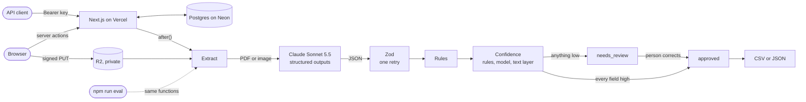

# Docwise

AI extraction of supplier invoices that you can check. Upload a PDF or a photo; Docwise returns the supplier, dates, amounts and line items, checks every value with business rules, and sends anything it isn't sure of to a person instead of straight into the books.

The app is the demo; the evaluation is the proof. A generated, labelled test set and `npm run eval` report per-field accuracy, line-item F1, review rate and **escaped errors** (wrong values marked high confidence), with every number linked to a report in [`docs/measurements`](docs/measurements).

> **Status: complete (Day 5 of 5).** Upload, extraction, validation, rule checks, per-field confidence, automatic approval, the review queue with corrections, CSV export, the 60-invoice test set, the eval with its [final held-out score](#final-score-held-out-split), the public demo with samples, the JSON API and the cost caps all work. See [PROGRESS.md](PROGRESS.md).

**Walkthrough video (86 s, narrated):** https://videos.bhupathi.dev/case-studies/docwise.mp4

## Try it

**https://docwise-extract.vercel.app**: no sign-up. Nine samples from the test set open straight away: a clean PDF, a German-format one, an Indian GST invoice, a scan, a phone photo, two pages, handwritten notes, and two that don't add up. They show the model's saved answers from [eval-02](docs/measurements/eval-02-v1-sonnet-5-5-tuning.md), so opening one makes no model call. A sample that waits for review can be copied into your browser and reviewed there, without changing it for anyone else. You can also upload your own invoice, or create an API key on [/developers](https://docwise-extract.vercel.app/developers).

## Architecture



Only validated values reach the database; the model's answer never does. The eval imports the app's own functions, so the scores describe the code that runs in production.

| Table | What it holds |
|---|---|
| `documents` | One uploaded file: its anonymous browser workspace, storage key, type, pages, status (`queued` → `extracting` → `needs_review` / `approved`, or `failed`), source (`upload` or `demo`), the sample it was copied from, runs so far, whether it had a text layer, how it was approved |
| `extractions` | One row per model call: model, prompt version, effort, raw response, tokens, milliseconds, fallback used, whether its answer was accepted, validation errors |
| `fields` | One row per field (and one for the line items): the extracted value, confidence and why, rule failures, the model's own doubt, and a reviewer's correction beside the original |
| `line_items` | The extracted lines: position, description, quantity, unit price, amount |
| `api_keys` | SHA-256 hash, a short prefix to tell keys apart, label, owning workspace, last use |
| `rate_limits` | Fixed-window counters per IP or key |
| `eval_runs` | Unused: the reports in `docs/measurements` are the record, so every cited number links to a file |

## How one invoice is processed

1. **Upload:** the browser sends the file straight to a private Cloudflare R2 bucket through a signed URL. The server then checks the stored file (type, size, page count) and queues it. Through the API, the file comes in the request body and gets the same checks, with its type judged by its bytes rather than its name.
2. **Extract:** Claude reads the PDF or image and answers in a strict JSON schema (structured outputs). The raw response, tokens and time of every call are logged.
3. **Validate:** the answer is parsed with Zod. A malformed answer goes back to the model once with the exact errors; a second failure is reported, never stored. **The model never writes to the database:** only validated values reach it.
4. **Check:** rules flag values that can't be right: impossible dates, a due date before the invoice date, a non-ISO currency, an amount the currency can't express, quantity × unit price ≠ amount, line items that don't add up to the subtotal, subtotal + tax ≠ total.
5. **Score confidence:** each field is **high** only if no rule implicates it, the model didn't list it as uncertain, and (for PDFs with a text layer) its value is actually printed in the document. Numbers and dates are matched by value, so `1.234,56 €` matches `1234.56`. A field the model left empty is low if the text shows one (a tax line, a date after "due"). Scans and photos have no text layer and rely on the first two signals. The reasons are stored with each field.
6. **Route:** every field high → **approved** automatically. Anything low → **needs review**.
7. **Review:** the reviewer sees the original on a "bench" next to an audit sheet, where every value carries an auditor's tick marks: ✓ vouched (found on the document), × extended (quantity × price = amount), Σ footed (the lines add up), ⊕ cross-footed (subtotal + tax = total), ? the model was unsure. A failed mark highlights the value. Flagged fields say why they were flagged. Line items can be edited, added and removed, and the rules re-run as you type. Changed values are stored as corrections next to the extracted ones, never over them. Approving while a check still fails (the invoice itself is wrong) needs an explicit tick. Values nothing downstream could use (an amount like `1,500.00`, a date that isn't one) block approval.
8. **Export:** approved invoices download as CSV, one row per line item with the invoice fields repeated, corrections applied. Text cells that a spreadsheet would run as a formula are neutralised. The API returns the same values as JSON.

A failed or interrupted extraction can be retried, up to three runs per document. Visitors see a plain message; the exact error stays in the extraction log.

## Test set

60 invoices in [`test-set/`](test-set), generated by `npm run generate:invoices` from a seed, so the same number always gives the same invoice. Five layouts (US, EU, UK, Indian GST and an international studio layout across AUD, CAD, JPY, CHF and SGD) use their local number and date conventions (`1.234,56 €`, `₹1,23,456.00`, `CHF 1’234.50`, `04/21/2026` vs `21/04/2026`). Every company and address is invented. Each invoice's true values are saved as JSON in [`test-set/truth/`](test-set/truth), and [`manifest.json`](test-set/manifest.json) lists each file's split, kind and media type.

| Slice | Invoices | What makes them hard |
|---|---|---|
| Clean | `inv-001`–`inv-045` | Nothing: crisp PDFs with a text layer, 1–15 line items, split taxes (CGST + SGST), extra columns (HSN/SAC) |
| Scans | `inv-046`–`048`, `059` | Image-only PDFs: greyscale, tilted, soft, low contrast, grain |
| Phone photos | `inv-049`–`051` | JPEGs at an angle on a desk, with perspective, shadow and warm light |
| Multi-page | `inv-052`–`054` | 30–40 line items over two pages, header row repeated, running footer |
| Handwritten notes | `inv-055`, `057` | A colour scan of a printout with notes such as "PO 83927" or "paid 22/08 by transfer", numbers that aren't the invoice's |
| Don't add up | `inv-056`, `058`, `060` | The printed total, a line amount or the subtotal is wrong on purpose. The true values are what's printed; the right outcome is review, never automatic approval |

The split is fixed: every third invoice is held out (20 of 60, including one of each hard kind). Prompts and checks are tuned on the other 40 only. The held-out invoices are scored once, for the final report.

## Evaluation

`npm run eval` runs every invoice of a split through the same steps as the app (input preparation, extraction with its retry, confidence, routing) and scores the outcome against the truth files:

- **Per-field accuracy** after normalising: amounts by value, dates as ISO dates, names ignoring case and spacing.
- **Line-item F1**: extracted lines are matched to true lines in any order, on description, quantity, unit price and amount.
- **Documents fully correct**: every field and every line right.
- **Review rate** and **escaped errors**: wrong values marked high confidence, and invoices approved automatically although a value was wrong or the invoice doesn't add up.
- **Cost and time per document**, median and p95.

Each run writes a JSON report (the record), a markdown summary and the model's raw answers to [`docs/measurements`](docs/measurements). The tests re-score every saved run from those answers and expect the same metrics, so CI checks the scoring with no API key and no model calls.

### Final score: held-out split

The 20 held-out invoices were scored once, after tuning had ended, with the app's prompt (v1) and model (Sonnet 5.5). Nothing was changed afterwards.

| | [Held out: Sonnet 5.5, prompt v1](docs/measurements/eval-04-v1-sonnet-5-5-held_out.md) |
|---|---|
| Header fields correct | 100.0% |
| Line-item F1 | 100.0% |
| Documents fully correct | 20/20 |
| Review rate | 5.0% (1/20) |
| Escaped errors (fields / documents) | 0 / 0 |
| Cost per document (median / p95) | $0.0115 / $0.0170 |
| Time per document (median / p95) | 3.1 s / 5.6 s |

The one invoice sent to review was `inv-060`, whose line items don't add up to its printed subtotal, on purpose; the other 19 were approved automatically, and all were right. Two limits on what this shows: 20 invoices is a small sample, so 0 escaped errors means none occurred here, not that the rate is zero; and the invoices are generated, so real supplier invoices (unusual layouts, stamps, poor scans) will be harder than these.

### Tuning split

40 invoices; the prompt was written against these, so treat them as an upper bound.

| | [Opus 5.5, prompt v1](docs/measurements/eval-01-v1-opus-5-5-tuning.md) | [Sonnet 5.5, prompt v1](docs/measurements/eval-02-v1-sonnet-5-5-tuning.md) | [Sonnet 5.5, bare prompt](docs/measurements/eval-03-bare-sonnet-5-5-tuning.md) |
|---|---|---|---|
| Header fields correct | 100.0% | 100.0% | 100.0% |
| Line-item F1 | 100.0% | 100.0% | 100.0% |
| Documents fully correct | 40/40 | 40/40 | 40/40 |
| Review rate | 5.0% | 5.0% | 12.5% |
| Escaped errors (fields / documents) | 0 / 0 | 0 / 0 | 0 / 0 |
| Cost per document (median / p95) | $0.0254 / $0.0390 | $0.0111 / $0.0173 | $0.0251 / $0.0417 |
| Time per document (median / p95) | 5.0 s / 9.0 s | 3.1 s / 5.0 s | 6.3 s / 14.0 s |

- With prompt v1, the only invoices sent to review were the two that don't add up on purpose (`inv-056`, `inv-058`). Every other invoice was approved automatically, and every one of them was right.
- Sonnet 5.5 matched Opus 5.5 at under half the cost per invoice, so the app uses Sonnet 5.5.
- The **bare prompt** is v1 without its rules for values (date and number formats, currency codes, supplier vs customer, split tax, copy rather than correct). Without them Sonnet copied dates and amounts as printed (`04/21/2026`, `$4,040.05`). Every first answer failed validation, and the retry, which sends back the exact errors, fixed all 40. The values came out right, but it took two calls per invoice, more than doubling cost and time. Three more invoices went to review, because the model listed dates like `10/03/2026` as ambiguous and a due date given only as payment terms as uncertain; v1 settles both. The rules make the first answer usable.
- The tuning split has only 10 hard invoices (3 scans, 2 photos, 2 multi-page, 1 handwritten, 2 that don't add up).

## API

The same flow as JSON. Create a key on [/developers](https://docwise-extract.vercel.app/developers). It is shown once and stored as a SHA-256 hash, and it acts for the browser that created it, so invoices sent with it also appear in that browser's inbox and review queue.

| Endpoint | What it does |
|---|---|
| `POST /api/v1/invoices` | Sends a file (multipart, field `file`, up to 4 MB). Answers 202; the model reads it in the background |
| `GET /api/v1/invoices/:id` | Status, the values with corrections applied, what the model read, each field's confidence and why, failing checks, tokens, time and cost |
| `GET /api/v1/invoices?status=needs_review` | This key's invoices, newest first |
| `POST /api/v1/invoices/:id/approve` | Approves with partial corrections (`{"invoice": {"total": "6782.62"}}`), or `"accept_failing_checks": true` for an invoice that doesn't add up as printed |

```bash
curl -X POST https://docwise-extract.vercel.app/api/v1/invoices -H "Authorization: Bearer $DOCWISE_KEY" -F file=@invoice.pdf
curl https://docwise-extract.vercel.app/api/v1/invoices/sample-056 -H "Authorization: Bearer $DOCWISE_KEY"
```

Errors are JSON (`{"error": {"code", "message", "details"}}`) with a stable code: 401 bad key, 403 approving a sample, 404, 409 not waiting for review, 413/415 file size or type, 422 can't read or can't approve, 429 rate limit or daily cap (with `Retry-After`).

## Cost control

The public demo spends one API key, so:

- **Daily caps across all visitors** (browser and API together, rolling 24 hours): 50 uploads, and $2 of model use estimated from the logged tokens at list prices. Retries count toward the budget.
- **Rate limits:** 10 uploads an hour per network, 60 API requests a minute per key, 3 keys per browser.
- **Size limits:** PDFs up to 5 pages; 10 MB from the browser, 4 MB through the API; 3 extraction runs per document.
- **Samples are free:** samples and visitors' copies of them make no model call and count toward none of the caps.

The counters live in a Postgres table, one upsert per request, so there is no extra service to run.

## Run it locally

Needs Node 20.9+ and Postgres.

```bash
npm install && cp .env.example .env.local   # then set DATABASE_URL, and DOCWISE_FAKE_MODEL=1 + STORAGE_DRIVER=local to run without keys
npm run db:migrate && npm run seed:samples
npm run dev
```

```bash
npm test             # unit and database tests (PGlite, in-process Postgres; the model is faked)
npm run test:e2e     # Playwright on a production build: fake model, local storage, its own database (E2E_DATABASE_URL)
npm run typecheck
npm run lint
```

```bash
npm run eval -- --max-usd 3                                # tuning split, the app's prompt and model (needs ANTHROPIC_API_KEY)
npm run eval -- --model claude-opus-5-5 --prompt bare      # another model or prompt version
npm run eval -- --replay eval-02-v1-sonnet-5-5-tuning      # re-score saved answers: free, no API calls
```

## Stack

Next.js 16 (App Router, server actions) · TypeScript · Postgres (Neon) with Drizzle · Claude Sonnet 5.5 via the Anthropic API (structured outputs, PDF and image input) · Zod · Cloudflare R2 · Tailwind CSS · Vitest + PGlite · Playwright · Vercel.

## License

MIT
